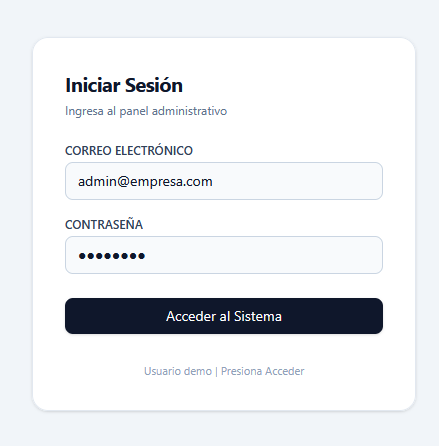
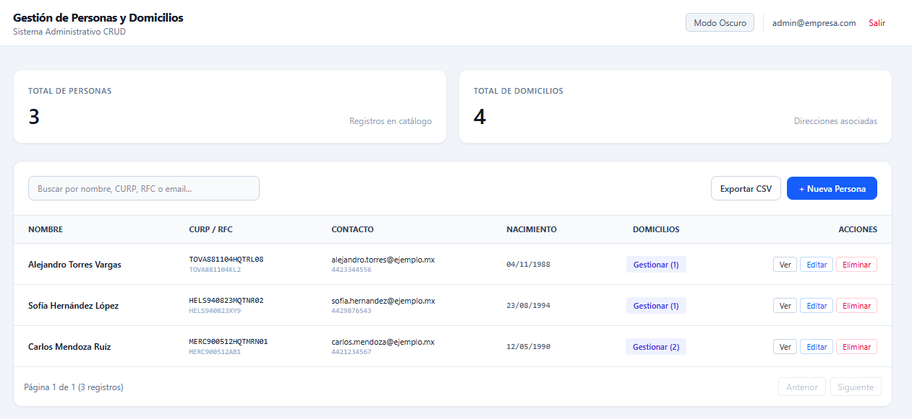
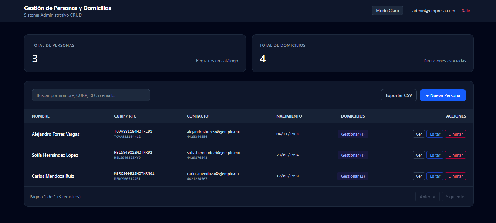

# Sistema de Gestión de Personas y Domicilios

## Guía de ejecución

### 1. Clonar el repositorio
```bash
git clone
cd vemasmas
```

### 2. Iniciar la Base de Datos
```bash
docker compose up -d
```

### 3. Ejecutar el Backend
Abre una terminal en la carpeta backend:

```bash
cd backend
mvn spring-boot:run
```

### 4. Ejecutar el Frontend
En una segunda terminal, dirígete a la carpeta frontend:

```bash
cd frontend
npm install
npm run dev
```
La aplicación web estará disponible en: http://localhost:5173.

---

## Credenciales de Acceso

El sistema cuenta con una pantalla de acceso simulada:
- **Correo Electrónico:** admin@empresa.com
- **Contraseña:** admin123 (cualquier contraseña de 6 o más caracteres)

---

## Documentación Interactiva

Una vez iniciado el backend, puedes acceder a la documentación interactiva y probar los endpoints desde:
- **Swagger UI:** [http://localhost:8080/swagger-ui.html](http://localhost:8080/swagger-ui.html)

---

## Pruebas Unitarias

Para ejecutar la suite de pruebas unitarias del backend:

```bash
cd backend
mvn test
```

---

## Capturas de Pantalla

| Vista | Captura |
| :--- | :--- |
| **Inicio de Sesión** |  |
| **Dashboard** |  |
| **Modo Oscuro** |  |
| **Alta de Persona** |  |
| **Edición de Persona** |  |
| **Administración de Domicilios** |  |
| **Detalle de Persona** |  |
| **Documentación Swagger UI** |  |

---